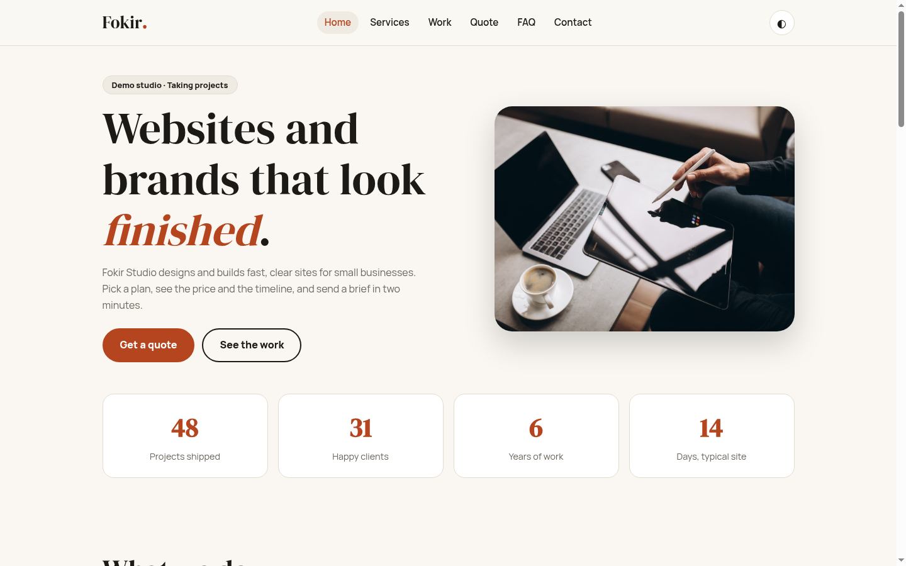
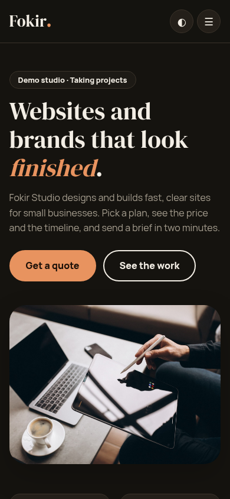

# Fokir Studio (landing page demo)

A freelancer landing page with working parts: a portfolio filter, a live project quote calculator, FAQ, validated contact form (opens your email app), dark mode and a mobile menu. Plain HTML, CSS and JavaScript, no build step.

**Live demo:** https://malakmo7amed309.github.io/fokir-landing/

| Desktop | Mobile |
| --- | --- |
|  |  |

## Features

- Quote calculator: plan, page count (multi-page site), extras and rush delivery update the price and timeline as you click. "Send this brief" fills the contact message.
- Portfolio filter (All, Product, Branding), animated stats, accordion FAQ.
- Contact form with validation. It opens your email app with the message filled in. Nothing is stored. The address is a placeholder.
- Dark and light mode (remembered), section highlight in the nav, skip link, focus styles, reduced-motion support.
- All names, numbers and projects are placeholders (demo).

## Code

`logic.js` holds the pure functions (quote, filter, validation) with tests: `npm test`. `app.js` is the interface.

```bash
python3 -m http.server
```
